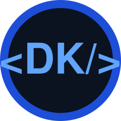

<table>
  <tr>
    <td width="130" align="center">
      
    </td>
    <td>
      <h1>김현섭</h1>
      <b>@devkimhyeonseop</b> 
      📚 매일 학습 기록 중 · 🗂️ 재생목록 3개
    </td>
  </tr>
</table>

배우면서 직접 만들고, 기록으로 성장하는 개발자입니다. **…더보기**

**[홈](#-채널-소개)** · **[재생목록](#-재생목록)** · **[최근 업로드](#-최근-업로드)**

---

## 📌 채널 소개

C#/C++를 공부하고, 네트워크·리눅스 인프라 기반도 함께 쌓고 있습니다.
매일 학습한 내용을 기록하며 꾸준히 성장하고 있습니다.

## 📂 재생목록

| 재생목록 | 주제 |
|---|---|
| 💻 Programming | C#, C++ |
| 🌐 Infra & Network | Linux, 네트워크, 클라우드 |
| 🛠️ Tools | Git, GitHub |

## ▶️ 최근 업로드

**오늘의 TIL — 매일 한 걸음, 기록으로 남깁니다**
[TILWithClaude](https://github.com/devkimhyeonseop/TILWithClaude)
